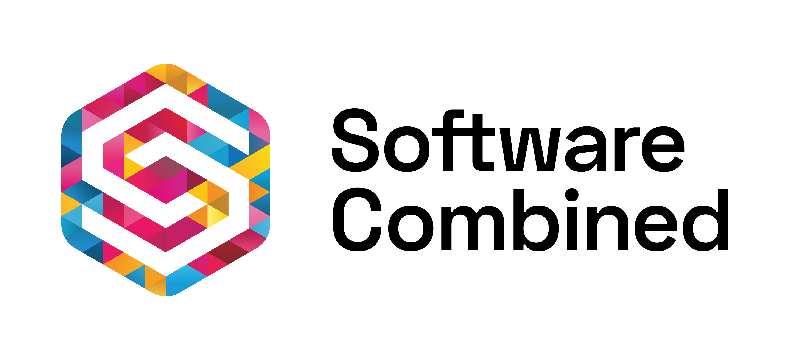
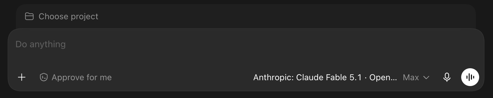

  <picture>
    <source media="(prefers-color-scheme: dark)" srcset="docs/assets/sc-logo-wide-dark.png">
    
  </picture>

<h1 align="center">SC AI Router</h1>

Route signed-in coding clients and separately billed OpenRouter or AWS Bedrock models locally.

  
  
  

SC AI Router runs on your computer and connects your coding assistants to the
models you choose. For example, you can keep a chat open and switch between
a subscription model and an approved model billed to your own OpenRouter key.

| About the project | Details |
|---|---|
| Who it is for | Software Combined staff using Codex or Claude |
| Status | Claude Code is in preview; [tested setups and remaining checks](docs/compatibility.md) |
| Maintained by | Cyril Allart and Brent Maxwell; [contribution rules](CONTRIBUTING.md) |

SC AI Router is independent software. OpenAI, Anthropic and OpenRouter do
not endorse this release. Claude gateways retain the signed-in client's
own authentication. Anthropic documents gateway configuration but does not
endorse, maintain or audit third-party gateways. It does not support non-Claude
models in Claude Code. Other Messages-compatible
routes keep truthful vendor IDs and are outside that client support boundary.
See [integration scope and data flows](docs/publication.md) for release decisions.

## Get started

Open **SCG Router** for its Mac menu bar or Windows/Linux tray controls.
Switch connections, repair setup and manage updates from the
[desktop menu](docs/desktop-menu.md).

Have your assistant installed and an OpenRouter key if you want to use models
billed to OpenRouter. Those models cost money and have no local spend cap.
An AWS Bedrock API key is optional and only enables the Bedrock models;
see [setup options](docs/setup.md).

1. Open [SCG Router setup and repair](https://dist.softwarecombined.com/install/)
   and choose your computer. You do not need a download sign-in or GitHub account.
2. Run setup and choose the assistant you use. Enter your key only in the
   setup window when prompted; never paste it into a chat or support ticket.
   On Microsoft Windows 11 x64, use the supplied `bootstrap.ps1` in PowerShell.
   You do not need to install Python. If Windows blocks the script, contact IT.
3. Quit and reopen your assistant, select a model labelled `· OpenRouter`,
   and send a short greeting. For Claude desktop, setup offers to switch Claude
   to OpenRouter instead. Claude restarts on OpenRouter. The first switch sets
   up that profile; switch back and forth once to bring your saved Code tasks.

You should see the model in the picker and receive a reply. Installation alone
does not confirm that the assistant works. See [setup options](docs/setup.md)
for prerequisites, changing assistants and installation from source.

If you already use Router, run the current setup once to update or repair it.
Your keys, saved channel and connected assistants remain in place. See
[recovery instructions](docs/recovery.md) for older installations.
The [release checklist](docs/native-installers.md) records native installer acceptance.

## Switch to OpenRouter and back

Changing the model and changing the assistant's connection are separate steps.
If Codex's **Send button is greyed out** after your ChatGPT allowance runs out,
selecting an OpenRouter model alone may not help. Use the connection steps below.
OpenRouter replies charge your OpenRouter key, even when a subscription is unavailable.

| Assistant | Mac, Windows and Linux |
|---|---|
| Codex | Open **SCG Router → Codex**, then choose **OpenRouter only** or **ChatGPT + OpenRouter**. Confirm the required restart. |
| Claude desktop | Open **SCG Router → Claude**, then choose **OpenRouter** or **Claude subscription**. Confirm the required restart. |
| Claude Code in the terminal | Use `/model` to choose a Claude-family OpenRouter or subscription model. Keep your Claude subscription sign-in. |

For **Codex without ChatGPT subscription access**, choose **No subscription**
in the key setup window.
That connection needs no ChatGPT sign-in. Switch back only after subscription
access returns, then select a subscription model. Your existing sign-in stays in place.

The menu preserves the connections needed to resume saved Codex chats in both modes.
Claude shares saved Code tasks using the existing account binding.
Cowork tasks stay in their original profile.

For **Claude without subscription access**, this repo currently rejects
`--claude-mode none`. Use Codex's OpenRouter connection or contact IT about
Claude access. An OpenRouter key alone does not establish that Claude setup works.

After either switch, select the intended model and send a short greeting.
Check that you receive a reply. The existing Mac switch shortcuts remain available.
See the [desktop menu guide](docs/desktop-menu.md),
[Codex switching](docs/operations.md#switch-codex) and
[Claude desktop setup](docs/claude-code.md#claude-desktop-app).
The [compatibility record](docs/compatibility.md) distinguishes source checks from native desktop acceptance.

If you are reading the installed `<home>/README.md`, open
`<home>/releases/<version>/README.md` for working guide links. The default home is
`~/.codex/mixed-model-router` (`%USERPROFILE%\.codex\mixed-model-router` on
Windows); read `<version>` from `<home>/current`.

  

Rows labelled <code>· OpenRouter</code> charge your OpenRouter key.

## Use it

- Switch models mid-thread from the picker to keep working in the same chat.
  Codex offers subscription and OpenRouter models. Claude Code's supported
  gateway scope is Claude-family models; other vendors remain unsupported.
- Claude desktop's gateway profile uses OpenRouter models. Its subscription
  remains in the signed-in profile; see [Claude setup](docs/claude-code.md).
- Generate images on the originating chat's connection: native OpenAI chats
  keep OpenAI images; OpenRouter chats use OpenRouter images. GPT Image 2 is
  separate from the selected conversation model. OpenRouter-only profiles
  need no ChatGPT sign-in. An explicit command can save completed video jobs.
  See [media generation](docs/media-generation.md).
- Updates install automatically. Restart the assistant when asked to load
  new models. See [update and recovery instructions](docs/operations.md).

The router also delivers SCG tools for code review, agent coordination,
documentation and other work. See [agent plugins](docs/agent-plugins.md).

On native routes the router may add its own instructions and recovery guidance;
the signed-in client's credentials are forwarded to its native provider.

Switching keeps text and tools within the new model's limits. Images become
a note that the model cannot read them; unsupported reasoning levels are rejected.

## Limits and important notes

Subscription models use the assistant's own sign-in. OpenRouter models use your
local key; subscription credentials never accompany an OpenRouter request.
Watch paid usage in the OpenRouter dashboard. Switching models sends the
available conversation history and tool results to the selected provider.
Subscription helper fallback is off by default; enabling it explicitly also
sends eligible title/summary requests to OpenRouter and charges that key.

macOS and Linux are supported; check the [Linux desktop requirements](docs/setup.md#before-you-start).
Windows sign-in relaunch and complete Claude desktop
task sharing still need confirmation. Models marked Preview also have
unfinished checks. See [compatibility](docs/compatibility.md).

Archiving and automatic chat titles do not work while Codex uses its
OpenRouter connection. Experimental [compaction](docs/operations.md#experimental-compaction)
sends selected history to an external service and bills its key; confirm that
sharing is permitted before enabling it. Logs exclude request content, keys
and tokens; see [security](SECURITY.md).

## Help

If a model is missing, quit and reopen the assistant first. For other symptoms,
use [troubleshooting](docs/troubleshooting.md) or open a project support issue. Software Combined IT support is for staff;
external users have no guaranteed response or service level.
Include what you tried and the error message. For diagnostics, use the redacted
support bundle described in that guide, never raw state, logs or credentials.

Report a suspected vulnerability by contacting the repository maintainers through an established private channel, as described in [SECURITY.md](SECURITY.md).

## For maintainers

The runtime uses Python 3.14 and its standard library. See
[development setup and required checks](CONTRIBUTING.md),
[architecture](docs/architecture.md) and [operations](docs/operations.md).

Branch from `development` and target pull requests at `development`. Maintainers
promote releases to `main`; release tags and verification follow
[the release procedure](docs/operations.md#how-to-ship).
The release bundle includes the README, Markdown guides and licence files;
images and contribution instructions are available in the repository.

## More information

| Guide | When to use it |
|---|---|
| [Setup](docs/setup.md) | Install, change assistants or build from source |
| [Operations](docs/operations.md) | Update, roll back, diagnose or uninstall |
| [All documentation](docs/README.md) | Find model, compatibility and deeper technical guides |

## Licence

SC AI Router is open source under the [Apache License 2.0](LICENSE). You can use,
modify and redistribute it, including commercially, under the terms of that
licence. Attribution and licence notices must be preserved as the licence
requires.

- Licence: [LICENSE](LICENSE)
- Notices: [NOTICE](NOTICE)
- Third-party material: [THIRD_PARTY_NOTICES.md](THIRD_PARTY_NOTICES.md)
- Official licence text: <https://www.apache.org/licenses/LICENSE-2.0>

Copyright 2026 Software Combined Pty Ltd. Maintained by Cyril Allart at [Software Combined](https://www.softwarecombined.com).
