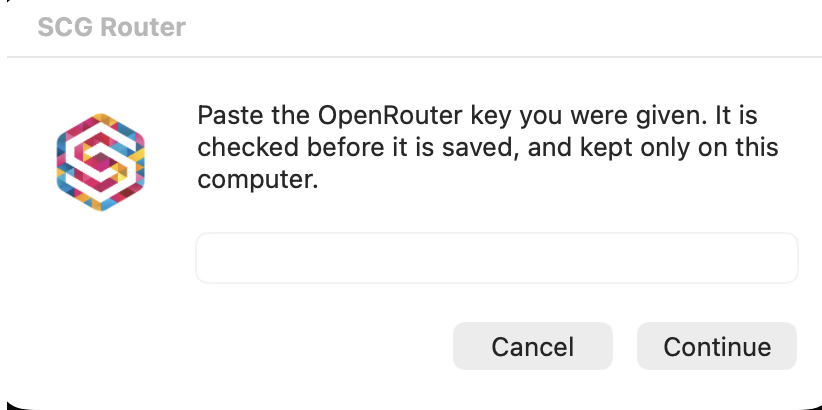
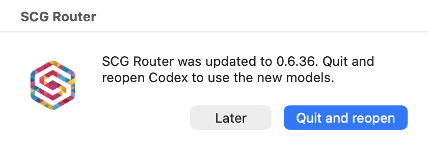

<p align="center">
  <picture>
    <source media="(prefers-color-scheme: dark)" srcset="docs/assets/sc-logo-wide-dark.png">
    
  </picture>
</p>

<h1 align="center">SC AI Router</h1>

<p align="center">
One local endpoint for Codex and Claude Code, with approved OpenRouter models in the picker and separate subscription billing.
</p>

<p align="center">
  <a href="https://github.com/software-combined/SC_AI_Router/actions/workflows/check.yml"></a>
  <a href="https://github.com/software-combined/SC_AI_Router/releases/latest"></a>
  <a href="LICENSE"></a>
  
</p>

SC AI Router is a small service that runs on your own machine. It speaks the
Codex and Claude Code wire protocols on a loopback port. Codex and the
Claude Code terminal client can use their subscription alongside approved
models billed to an OpenRouter API key. Claude desktop uses a separate
gateway profile with the approved OpenRouter models; its native subscription
picker stays in the signed-in profile. Local task sharing between desktop
profiles is under development; see the [candidate limits](docs/compatibility.md).

The billing split is strict. Subscription models keep using the client's
own sign-in, OpenRouter models use a key stored only on your machine, and
subscription credentials never accompany a request billed to OpenRouter.

- **One router, two clients.** Codex (desktop app or CLI) and Claude Code
  attach to the same service, with per-turn model selection.
- **Billing you can see.** Rows billed to the OpenRouter key carry an
  `· OpenRouter` suffix; every other row uses the subscription.
- **Small trust surface.** Loopback only, one per-install path token, an
  owner-only key file, and no request content in logs.
- **No dependencies.** Python 3.14 standard library at runtime; the
  bootstrap brings its own pinned interpreter.
- **Self-updating.** Every install follows a public, token-free release feed
  on macOS, Linux and Windows.

## What it looks like

<p align="center">
  
</p>
<p align="center"><sub>The Codex composer with an OpenRouter-billed row selected. Rows billed to the API key carry the <code>· OpenRouter</code> suffix; the rest use the subscription.</sub></p>

<table align="center">
  <tr>
    <td align="center"></td>
    <td align="center"></td>
  </tr>
  <tr>
    <td align="center"><sub>The first-run key window. The key is checked before it is saved and kept only on that computer.</sub></td>
    <td align="center"><sub>The update notice. Updates install themselves; this dialog only appears when new picker models need a client restart.</sub></td>
  </tr>
</table>

## Platform support

| Platform | Service | Status |
|---|---|---|
| macOS | launchd user agent | Supported |
| Linux with a systemd user manager (x86_64 and arm64/glibc) | systemd user units | Supported |
| Windows 11 x64 | per-user Scheduled Tasks | Install, update, rollback and uninstall verified; sign-out and sign-in relaunch still to be confirmed |

Linux needs a running systemd user manager in the signed-in desktop session;
the installer refuses a bare SSH session without one. Acceptance evidence and
the client versions it was recorded against live in
[docs/compatibility.md](docs/compatibility.md).

## Requirements

- Codex (desktop app or CLI) and/or Claude Code, installed and signed in.
- Python 3.14 for a source install. The bootstrap supplies a pinned runtime,
  so no system Python 3.14 is needed; macOS and Linux still need any
  `python3`, plus `curl`, `tar` and either `shasum` or `sha256sum`.
  Windows needs no Python.
- An OpenRouter API key for any model billed to OpenRouter.

The router home is `~/.codex/mixed-model-router`
(`%USERPROFILE%\.codex\mixed-model-router` on Windows). Installed releases,
state, the key file and logs live there.

## Install

### From a checkout

Needs Python 3.14. Build a local release, then install from it:

```sh
git clone https://github.com/software-combined/SC_AI_Router.git
cd SC_AI_Router
python3.14 packaging/release.py --out dist --url-base "file://$PWD/dist"
python3.14 packaging/install.py --feed "file://$PWD/dist/latest.json"
```

On Windows, run the same commands from PowerShell with the Python launcher:

```powershell
py -3 packaging/release.py --out dist --url-base "file://$PWD/dist"
py -3 packaging/install.py --feed "file://$PWD/dist/latest.json"
```

### Bootstrap for Software Combined staff

Ask a maintainer for the bootstrap script through Software Combined's
internal channels. It needs no GitHub account, token or repository access:
it downloads the pinned Python runtime and release bundle from the release
feed, verifies both checksums and installs the per-user service.

`--channel=beta` (PowerShell: `-Channel beta`) follows pre-releases.

### What the installer does

The installer verifies the bundle checksum, self-tests the runtime, installs
the per-user service and writes the client configuration. If the installed
service has no OpenRouter key, the key window opens by itself and collects
it; a coding agent running the install must never handle the key. If no
window appears, re-run the installer with `--setup`: it restarts the current
release with a fresh setup link. A key exported in the invoking shell is not
passed to the installed service, so it does not count as configured.
`ROUTER_NO_KEY_WINDOW=1` suppresses only the dialog for unattended installs.
Restart the client so it picks up the router's model catalogue.

The installer commands in this README run from a checkout. A bootstrap
install ships the same installer at
`<home>/releases/<version>/packaging/install.py`, where `<version>` is the
version recorded in `<home>/current`; run it with the pinned interpreter at
`<home>/runtime/python/bin/python3.14` (`python.exe` under the same path on
Windows) when the host has no Python 3.14 of its own. Before a checkout
install, `--preflight` reports missing prerequisites without writing
anything, and `--dry-run` shows what an install would do.

## Clients

The installer asks which assistant you use and where, then attaches only that:
ChatGPT (its app and terminal share one attachment), the Claude desktop app,
Claude Code in the terminal, both Claude surfaces, or both assistants. Cancel
at either question attaches nothing and detaches nothing, so an existing setup
is untouched; only a machine with no dialog available keeps the installer's
default, which is Codex. A fresh install asks when it can show a dialog,
`--choose-clients` asks again on a machine that is already attached, and
`ROUTER_NO_CLIENT_CHOOSER=1` suppresses the question for unattended runs. The
flags below stay authoritative whenever they are passed:

- ChatGPT app or terminal: `python3.14 packaging/install.py --clients codex`
- Claude Code terminal: `python3.14 packaging/install.py --clients claude`
- Claude desktop app: `python3.14 packaging/install.py --clients none --desktop`
- both Claude surfaces: `python3.14 packaging/install.py --clients claude --desktop`
- the service alone: `python3.14 packaging/install.py --client none`

Each of those attaches on a machine that is already up to date, so the choice
can change at any time without waiting for a release. Attaching is additive:
the installer never detaches a client you did not ask it to remove.

A machine installed from the bootstrap needs no checkout. Re-run the published
bootstrap with the flag, or run the installer already in the router home with
its pinned interpreter (Windows: `.\bootstrap.ps1 -Channel beta -ChooseClients`):

```sh
curl -fsSL https://dist.softwarecombined.com/bootstrap/bootstrap.sh -o bootstrap.sh
sh bootstrap.sh --channel=beta --choose-clients
"$HOME/.codex/mixed-model-router/runtime/python/bin/python3.14" "$HOME/.codex/mixed-model-router/releases/$(cat "$HOME/.codex/mixed-model-router/current")/packaging/install.py" --choose-clients
```

For the **Claude desktop app**, quit and reopen Claude after attaching, then
choose **Code**, a folder and a model. All gateway rows are billed to
OpenRouter. The candidate **Switch Claude** launcher shares local tasks before
changing connections. **Open Claude** opens the current connection. Complete
native task-sharing acceptance remains pending. See
[desktop setup and limits](docs/claude-code.md#claude-desktop-app).

**Claude Code in the terminal** (preview) is `--clients claude` from the list
above, then restart Claude Code. It keeps your Claude subscription sign-in,
and the router's OpenRouter models appear in its `/model` picker next to your
subscription models. Never set `ANTHROPIC_API_KEY` or `ANTHROPIC_AUTH_TOKEN`:
either one overrides the subscription sign-in. The full walkthrough, including
the manual alternative and how to check it worked, is in
[docs/claude-code.md](docs/claude-code.md#setup).

### Switch Codex

From version 26.917.51856, the ChatGPT app (Codex) stops sending messages once
your ChatGPT subscription reaches its usage limit, even for OpenRouter models.
Switch Codex works around this. It moves Codex to OpenRouter models until the
limit resets, then back to your ChatGPT subscription. Like Switch Claude,
Switch Codex is macOS-only in this beta. SCG Router adds Switch Codex to your
Applications folder when Codex uses your ChatGPT subscription and your ChatGPT
app is affected.

When the limit is reached, SCG Router offers to switch once. Choose **Open
Switch Codex**, or open Switch Codex from your Applications folder at any time.
Switch Codex asks before it changes anything, then quits and reopens the
ChatGPT app. It keeps the switch only after Codex has loaded the new settings,
so a switch that fails changes nothing.

When the limit resets, SCG Router offers the way back once. Choose **Open
Switch Codex** again, or open it yourself. Switching back does not depend on
the ChatGPT app: if Switch Codex cannot check the app, it asks you to quit the
app first and to open it again afterwards.

While Codex is switched:

- only OpenRouter models are listed, and they are billed to OpenRouter;
- a model that needs your ChatGPT subscription answers with a short message
  that says what to pick instead;
- Codex still asks you before it runs a command that needs approval;
- conversations you start while switched still open after you switch back.

Two things do not work while Codex is switched. Archiving a conversation fails
with "Failed to archive conversation", a ChatGPT app (Codex) issue, so switch
back to archive it. Conversation titles are not generated.

## Models and billing

Switch models mid-thread from the picker. The thread keeps its text history and
tools, subject to the new model's limits; image blocks become a note
that tells the model to say it cannot read them, and an unsupported
reasoning level is rejected with the levels the model accepts.

- Rows labelled `· OpenRouter` are billed to the OpenRouter API key. The
  remaining rows use the ChatGPT or Claude subscription.
- ChatGPT subscription models are discovered automatically from Codex's
  native model catalogue, so a new subscription model does not need a router
  release to appear.
- The GPT twins appear on both routes, so a subscription row and its
  OpenRouter twin are selectable side by side.
- Rows labelled Preview are usable but not yet verified; report anything odd.
- `--openai-mode none --setup` installs without a ChatGPT subscription and
  serves the picker entirely from OpenRouter.

There is no local spend cap. Subscription usage follows the client's plan and
OpenRouter usage is billed to the API key, so watch that spend in the
OpenRouter dashboard.

## Experimental compaction

The `jev-compaction` file beside `channel` in the router home opts external
model compactions into Jev judgments. This sends selected history text to
TypeSafe through the external provider and is billed to its key. Use it only
where that data sharing is permitted. Subscription threads are unaffected.

Start with `shadow`: it measures proposed changes but keeps today's summary.
`on` replaces that summary with retained text, preserving complete tool pairs
or a 300-character output with an explicit truncation note. What the judge
sees is the call text and a status or length label for each candidate, never
the result body, so a failure that lives only inside a result's text is not
visible to it; keep `on` experimental until shadow data has calibrated it.
Errors and size limits fall back to the bounded fast summarizer. It uses
Xiaomi MiMo V2.6 Flash first and DeepSeek V4.1 Flash after an unsent timeout or
incomplete output, so the summary can come from a different upstream vendor
than the active model. A timeout after dispatch fails closed to avoid duplicate
side effects. The switch is read at each compaction;
no restart is needed. Only lowercase `shadow` and `on` enable it; missing,
empty, unreadable or other values disable it. Surrounding whitespace is ignored.

macOS/Linux (run the line for the mode you want):

```sh
RH="${ROUTER_HOME:-$HOME/.codex/mixed-model-router}"
printf 'shadow\n' > "$RH/jev-compaction"  # Recommended first step
printf 'on\n' > "$RH/jev-compaction"      # Enable replacement
rm -f "$RH/jev-compaction"                # Disable
```

PowerShell:

```powershell
$rh = if ($env:ROUTER_HOME) { $env:ROUTER_HOME } else { Join-Path $HOME '.codex/mixed-model-router' }
Set-Content "$rh/jev-compaction" shadow -Encoding ascii # Recommended first step
Set-Content "$rh/jev-compaction" on -Encoding ascii     # Enable replacement
Remove-Item "$rh/jev-compaction" -ErrorAction SilentlyContinue # Disable
```

## Updates

Installs check their release feed for the selected channel. `stable` is the
default, and writing `beta` into the `channel` file in the router home selects
pre-releases. Switching channels by hand also means deleting `feed-serial`
beside it: the channels publish independently, so a higher serial left over
from the other channel refuses the new channel's updates. A `feed` file left
in the router home by an older install overrides the channel, so check or
remove it before relying on automatic updates. Checks run every four hours:
Linux also checks five minutes after the timer activates, and macOS checks
when the job loads. The feed needs no token, account or repository access,
and every bundle is verified by SHA-256 with version and identity checks;
the channel path also enforces the serial replay guard.

The outgoing process finishes requests it has already accepted before the
service restarts; on macOS launchd queues new connections through the
handover, while Linux and Windows refuse new connections until the new
process binds the port. After an update that adds picker models, the router
offers a client restart, names up to three of the models it added, and never
forces one; the prompts each platform shows are described in
[docs/operations.md](docs/operations.md#new-model-notifications).

- `python3.14 packaging/install.py --check-update` reports the installed and
  available versions without changing anything; `--update` applies one now.
- `python3.14 packaging/install.py --doctor` explains an unhealthy host in
  WARN/FAIL rows with a Fix line; `--support` writes a redacted bundle to
  attach to a support request.
- `python3.14 packaging/install.py --rollback --to <version>` (or its older
  spelling `--version <version>`) rolls back to a previously installed
  release; `--rollback` alone lists them.
- A `--feed <latest.json>` install uses that document for the run only; later
  checks follow the channel.

### Express updates

Maintainers can publish an urgent stable release with `v<VERSION>-express`,
or an urgent beta with `v<VERSION>-beta-express`. The tag includes the exact
semantic version from `packaging/VERSION`: `0.6.117` is `v0.6.117`. Use a new
tag for each release. These tags use the same tests, publisher permissions
and integrity checks as ordinary releases.

After installing an Express-capable version, macOS, Windows and Linux run
a separate lightweight Express check about every minute. Online machines
can begin an urgent update within a few minutes of feed publication;
downloads, request draining and health checks take additional time.
Each machine follows its existing stable or beta channel. Normal releases
continue on the four-hour schedule. A failed Express attempt waits for the
regular retry schedule, retaining the existing three-failure limit.

The jobs are `com.local.codex-mixed-model-router.update.express` on macOS,
`CodexMixedModelRouterUpdateExpress` on Windows, and
`codex-mixed-model-router-express.timer` on Linux. The installer registers
and removes these with the regular jobs. They use the same home launcher
under the name `express_launch.py`, which skips older restored releases
that do not support Express.

Existing machines first need this version through their current update
schedule or a manual update. Sleeping/offline machines check when available.
A missing interpreter or broken updater still needs local recovery.

## Uninstall

`python3.14 packaging/install.py --uninstall` stops and removes the service,
the update schedule and the client configuration. The state directory, key
file and loopback token are left in place for you to delete.

## Common commands

```sh
# Install or reinstall for the invoking client (add --clients both to attach both).
# With no key installed the key window opens by itself; --setup forces it.
python3.14 packaging/install.py

# Read-only checks: prerequisites, installed state, then the full doctor
# report with a Fix line per failing row (each takes --json for machines)
python3.14 packaging/install.py --preflight
python3.14 packaging/install.py --status
python3.14 packaging/install.py --doctor

# Apply an update now (the scheduled action), or read what the channel offers
python3.14 packaging/install.py --update
python3.14 packaging/install.py --check-update

# List the installed releases, or return to one of them
python3.14 packaging/install.py --rollback
python3.14 packaging/install.py --rollback --to <installed version>

# Write a redacted bundle to attach to a support request
python3.14 packaging/install.py --support

# Detach every client and remove the service (state and key stay behind)
python3.14 packaging/install.py --uninstall
```

`--update` installs a newer release when the channel has one; `--check-update`
only reports the installed and available versions. `--version <version>` stays
as the older spelling of `--rollback --to <version>`. If something looks wrong,
`--doctor` names the failing component and the fix, then read
[docs/troubleshooting.md](docs/troubleshooting.md).

## Diagnostics

- Health: `http://127.0.0.1:<port>/<token>/health`, with the port and token
  from `mixed-router-state.json` in the router home. Keep that URL private.
- `python3.14 packaging/install.py --status` reports the installed version,
  service state, feed source, channel and key state without printing secrets.
- From the installed release directory, `python3.14 -m ai_router.inspect_requests`
  shows recent request attempts, reported models and failure phases. See the
  [request evidence filters](docs/operations.md#request-identity-and-failure-evidence).
- A 400 means the model, payload or local key configuration is invalid. A 409
  means the provider cannot serve the request, for example an unsupported
  reasoning level after a model switch; the message names the allowed levels.
  A refusal on an OpenRouter turn names the provider code when one is present
  and says to switch the thread back to the previous model or start a new
  thread.
- A 503 with `Retry-After` means the request was not served: either the router
  is draining for an update (`SERVER_DRAINING`) or an upstream 429 was mapped
  to a retryable answer (`UPSTREAM_RATE_LIMITED`). The JSON body names the
  code; retry after the delay. When a subscription route refused the turn,
  the message names the model and the subscription and says to retry shortly
  or to select a routed model; routed models reached through the external
  provider keep the neutral text.
- Logs live under `logs/` in the router home, and `update.log` records the
  source of each install. A file there is deleted 30 days after its last
  write, at each router start and scheduled update, apart from the three the
  running router writes (`router.jsonl`, `launchd.log`, `update.log`), which
  keep their size caps (about 25 MB all in).

## Security

- The router listens on `127.0.0.1` only, and every request needs the
  per-install path token.
- The provider key file is owner-only (mode 600 on macOS and Linux, an
  `icacls` grant to the installing user on Windows), and the router refuses a
  key file with a widened ACL.
- Subscription headers never accompany an OpenRouter request.
- Logs carry request metadata, never request content, keys or tokens.

Report a suspected vulnerability privately to
<cyril@softwarecombined.com>, as described in [SECURITY.md](SECURITY.md).

## Architecture

The request path is layered, and dependencies point inward:

| Layer | Owns |
|---|---|
| `ingress.py`, `relay.py`, `router.py` | Loopback HTTP: authentication and body limits, GET routes, upstream relay, drain and POST orchestration |
| `protocols/` | Responses and Messages method and path dispatch |
| `providers.py`, `claude.py` | Upstream adapters for subscription and OpenRouter traffic |
| `provider_defs.py`, `registry.py` | One definition per upstream; model facts |
| `transport.py`, `upstream.py` | Header rules, streaming and upstream failure policy |
| `packaging/` | Installer, `bundle.py` release lifecycle, per-OS service backends and updater |

- A new external provider is a definition plus registry rows. A provider with a
  different wire format is a new adapter, never a branch in the request path.
- Client, provider and operating system are separate concepts; installer
  orchestration calls one explicit platform backend.
- The full map, including the modules still moving between owners, is in
  [docs/architecture.md](docs/architecture.md).

## Contributing and development

Pull requests are welcome; [CONTRIBUTING.md](CONTRIBUTING.md) has the branch
rules and the gates. The short version:

```sh
python3.14 -m unittest discover -s tests -t .
python3.14 -m compileall -q ai_router tools tests packaging
python3.14 tools/check_source_limits.py
python3.14 tools/check_policy_scans.py
```

The runtime is Python 3.14 with the standard library only; installer scripts
stay Python 3.9-compatible. Branches start from `develop`, pull requests
target `develop`, and user-visible changes update `CHANGELOG.md` and
`packaging/VERSION`. Release tags use the full `v<VERSION>` form matching
`packaging/VERSION`; for example, `0.6.117` is tagged `v0.6.117`.

## Agent plugins

This repo also hosts the private `scg-agent-plugins` marketplace:
`scg-review` (pre-commit review), `scg-subagents` (subagent coordination),
`scg-prototypes` (prototype publishing), `scg-finance` (finance analysis) and
`scg-documentation` (technical writing). Every plugin works in Codex and Claude
Code.

The router is the delivery channel. Its release bundle carries the plugin
trees, and each install or scheduled update that lands a new release
materialises a router-owned local marketplace and registers it with the
attached clients, so on a router host the plugins arrive and refresh with the
router and need no Git account, GitHub access or marketplace command. Once
Codex runs from that copy, the same pass retires any earlier Git-backed plugin
runner it recognises, with its macOS LaunchAgent or Linux systemd timer, since
that runner only ever refreshes Codex. A refused Linux scheduler operation
keeps the old files and reports retirement as pending, so a later install can
retry. A host without the router can still install the plugins from the Git
marketplace:

```sh
codex plugin marketplace add software-combined/SC_AI_Router --ref main
codex plugin add scg-review@scg-agent-plugins
```

Installing the router later moves that Codex registration to the router's own
copy. A plugin you turned off in Codex or Claude Code stays off.

Plugin releases ride `plugin.json` versions plus `plugins/CHANGELOG.md`,
separate from the router tag train (`packaging/VERSION` never moves for a
plugin-only change). See `AGENTS.md` section 9 for the plugin rules.

## Documentation

- [Architecture](docs/architecture.md)
- [Operations](docs/operations.md)
- [Troubleshooting](docs/troubleshooting.md)
- [Claude Code setup](docs/claude-code.md)
- [Adding a model](docs/adding-a-model.md)
- [Compatibility](docs/compatibility.md)
- [Installed runtime files](docs/runtime-files.md)
- [Provenance](docs/PROVENANCE.md)
- [All documentation](docs/README.md)

The release bundle carries this README, the `docs/` pages and the licence
files, so an installed host can read them offline. Everything else stays in
the repository, including `CONTRIBUTING.md`, `SECURITY.md`, `docs/assets/`,
`infra/`, `plans/` and `tests/`.

## Licence

SC AI Router is open source under the [Apache License 2.0](LICENSE). You can use,
modify and redistribute it, including commercially, under the terms of that
licence. Attribution and licence notices must be preserved as the licence
requires.

- Licence: [LICENSE](LICENSE)
- Notices: [NOTICE](NOTICE)
- Third-party material: [THIRD_PARTY_NOTICES.md](THIRD_PARTY_NOTICES.md)
- Official licence text: <https://www.apache.org/licenses/LICENSE-2.0>

Copyright 2026 Software Combined Pty Ltd. Maintained by Cyril Allart
(<cyril@softwarecombined.com>) at [Software Combined](https://www.softwarecombined.com).
