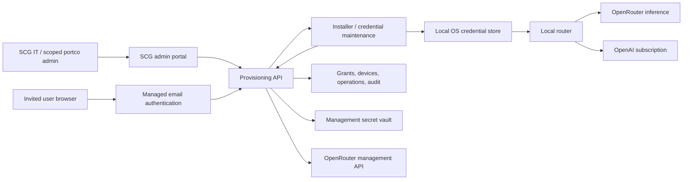

# Plan 048: Provision and manage OpenRouter access across portcos

> Executor: read this entire plan and both repositories' current instructions.
> This is a plan, not authority to deploy, send invitations, create paid keys,
> change production accounts, or publish a router release. Build and verify one
> vertical slice at a time after implementation is authorised. Record source,
> deployment, runtime verification and business acceptance separately.

## Status and first proof

- Status: TODO; design complete, implementation and live account checks pending.
- Priority: P1. Category: direction/security. Effort: L. Delivery risk: HIGH.
- Planned at router commit `1979e7f`, 2026-09-08; infrastructure reconnaissance
  at `fad37f24`. These are source snapshots, not runtime verification.
- Depends on existing credential/provider/installer functionality (040, 037,
  041). Does not depend on the blocked live catalogue plan 039 or model plan 046.
- First observable proof: an invited user outside SCG's Entra tenant installs
  on a clean Mac, verifies their email, receives a restricted individual key
  without seeing or pasting it, completes a synthetic OpenRouter request, and
  loses provider access when IT revokes that installation.
- Full acceptance adds a second portco/domain, lifecycle recovery, admin scope,
  budget enforcement, unattended updates, Business/Enterprise compatibility
  and the release/distribution gates.

## Product decision

Build a small SCG provisioning service. Keep inference on the existing local
router: OpenRouter traffic goes directly to OpenRouter; subscription traffic
goes directly to OpenAI with its existing authentication. The provisioning
service never receives prompts, tool payloads or ChatGPT credentials.

Admission is invitation-only and independent of Entra. Any deliverable email
domain can be invited. Email verification proves mailbox control; a separate,
active server-side grant provides authority, company assignment and budget.
Do not grant access from an email suffix, downloadable installer or client-
supplied portco identifier. Portco users need no OpenRouter login or AWS access.

V1 supports one active installation per user. Additional devices are a later
explicit product decision, requiring shared budget reservations across devices.
Portco transfers revoke the old grant and its keys before a new grant is issued.

### User and IT journeys

1. SCG IT registers a portco, its funding owner and policy; then invites a named
   email address with a monthly allowance. Start with central IT administration.
2. The invitation links to a non-secret download/help page. The same signed
   installer is used for everyone; downloading it grants no entitlement.
3. On first launch the installer opens a browser. The user signs in with an
   email OTP and confirms the installation code displayed on their Mac.
4. The service binds that session to the waiting installer, assigns the key,
   and the installer stores it in Keychain and completes local activation.
5. Subsequent launches, routine monthly key renewal and updates require no key
   handling. Re-enrolment is required after loss of the device credential.

This is zero manual API-key setup, not a claim that an unmanaged Mac can install
software without user/OS consent. Fully unattended enrolment is a later RMM/MDM
integration: approved deployment channels supply a unique, expiring, one-use
grant per device. Each portco can use its own deployment tooling; Entra is not
required. Do not place a company-wide bootstrap credential in packages.

## ChatGPT Business and Enterprise compatibility (required)

The owner expects ChatGPT Business (formerly Team) or Enterprise. Both are
required acceptance targets, not a claim that this custom adapter is already
certified for either. OpenRouter enrolment remains independent of Entra and
OpenAI sign-in. It does not create a ChatGPT seat or grant Codex access.

Use OpenAI's normal organisation sign-in, including SSO/MFA where configured.
Business/Enterprise installs use the existing `openai_mode=subscription` path
and native ChatGPT OAuth sign-in. Do not build a new organisation-auth flow or
use the no-subscription placeholder-key flow for these seats.
Preserve the selected workspace and its seat/local-Codex permissions. Support
a shared SCG workspace or different portco workspaces without inferring either
from an email suffix. Do not share accounts or send OpenAI tokens to the
provisioning service. OpenAI distinguishes sign-in, workspace rights and local
permissions in its [authentication guide](https://learn.chatgpt.com/docs/auth).

V1 adds no binding between the OpenRouter grant and an OpenAI workspace ID;
the two funded identities are deliberately independent. Users may select an
OpenAI workspace they are entitled to use, subject to its existing managed
policy. Where corporate policy requires workspace pinning, the workspace owner
must configure and prove the supported OpenAI restriction before rollout;
the broker never infers or implements that restriction from an email suffix.

`SubscriptionProvider.prepare()` already preserves `ChatGPT-Account-ID` and the
incoming bearer for OpenAI; `tests/test_providers.py` checks their exclusion
from OpenRouter. Extend those tests with synthetic workspace A/B headers,
refresh/re-authentication, restart and workspace switching. Never cache another
workspace's identity, replace subscription auth with a paid OpenAI API key, or
send native organisation/policy requests to OpenRouter.

Preserve effective admin-managed configuration, workspace restrictions,
approvals, tool controls and network policies. Verify policy retrieval with
the router enabled. The Slice 4 operator must identify the actual policy-fetch
host/path using supported, sanitized client diagnostics and determine whether
it goes directly to OpenAI or through the router. Do not assume today's four
`NATIVE_SERVICE_PATHS` cover managed configuration. Prove authenticated policy
retrieval and denial of a prohibited action; missing visibility leaves the
gate open. Never disable requirements, fabricate policy responses or
fall back to personal mode to make the adapter work. If organisational policy
or the client prevents approved external-provider use, stop that rollout at
the compatibility gate and escalate to its workspace owner. See
[managed configuration](https://learn.chatgpt.com/docs/enterprise/managed-configuration).

OpenAI plan usage/credits and OpenRouter charges remain separate; no automatic
provider fallback when one allowance is exhausted. OpenAI Enterprise retention,
residency, audit coverage and contracts must not be claimed for OpenRouter
traffic. Approve that external data path separately, including conversation
context forwarded when changing models. Verify required connectors/features
on the external route rather than assuming Enterprise feature parity.

| Required pilot | Evidence before claiming support |
|---|---|
| Business seat with local Codex access | Normal organisation sign-in; correct workspace; successful OpenAI and provisioned OpenRouter synthetic requests. |
| Enterprise seat with enforced policies | Actual SSO/MFA where configured, policy retrieval, permitted workflow success and intentionally prohibited action denied. |
| Personal and organisation workspaces on one user | Switching and re-authentication preserve the chosen account; no silent personal fallback. |
| Different portco OpenAI workspaces | Each independently approved SCG grant works; email domain does not choose either tenant. |
| Removed seat/workspace membership or unavailable required policy | Native denial remains intact; no local-service stub bypass. IT separately revokes the SCG grant as part of offboarding. |
| One provider hits its limit | Clear provider-specific error and billing attribution; no automatic charge to the other provider. |

Also compare the workspace's actual permitted OpenAI model roster with the
local picker and route selection. A model shown but rejected by the local
router fails this gate. This does not authorise unrelated catalogue work;
reconcile any required roster change before implementing it. Effective OpenAI
workspace permissions and authenticated provider availability are authoritative;
the local registry/picker can expose only an approved subset, not grant access.
The Slice 4 pilot operator records discrepancies and the router maintainer owns
a scoped reconciliation. Never widen workspace permissions to match a stale
local list; keep acceptance pending until the approved paths agree.

Include these prerequisites in Slice 0 and the live matrix in Slice 4. Add
`--scenario workspace-compatibility` to the proposed probe: offline default
tests synthetic headers/denials; real-workspace runs require explicit live
targets. Record OS, Codex version, seat type, workspace identifier, effective
policy and boolean outcomes, without tokens or raw sensitive policy payloads.
If only one tier is available, the other remains UNVERIFIED and its gate stays
open. The delivery estimate excludes procurement and workspace-access lead time.

This covers local Codex routing, not the ordinary ChatGPT web UI or OpenRouter
provisioning for Codex cloud workers. [OpenAI's admin rollout guide](https://learn.chatgpt.com/docs/enterprise/admin-setup)
separates workspace access, local runtime, cloud and Platform API boundaries.
Generic Codex entitlement is not evidence of official support for this adapter.

## Recommended architecture and ownership



| Component | Proposed implementation and boundary |
|---|---|
| End-user identity | Amazon Cognito managed login, email OTP, self-sign-up disabled, administrator-created passwordless users. Confirm required tier/region and email delivery during preflight. |
| Admin identity | Separate Cognito admin pool/client with mandatory password plus TOTP MFA; no public registration. Do not make email OTP alone sufficient for key administration. |
| Portal / downloads | Small SCG-branded web interface; private S3 origins with CloudFront HTTPS delivery. No credentials in static assets. Use installed Sites skills when implementing the website, and reconcile hosting output with the approved AWS source boundary before publishing. |
| API | API Gateway HTTP API and a small Node.js Lambda service; browser login handled by server-side OAuth code exchange, device endpoints use opaque credentials. Separate admin and device handlers/permissions. |
| State | DynamoDB on-demand with conditional writes/transactions, encryption and point-in-time recovery. Explicit expiry checks; TTL deletion is cleanup, not access control. |
| Secrets | AWS Secrets Manager for the OpenRouter management key and any server OAuth client secret. Runtime role access only; no desktop AWS credentials. |
| Maintenance | One scheduled reconciliation job for incomplete provider operations, revocation retries and metadata-only usage reconciliation; bounded retries and alarms. |
| Provider organisation | One SCG-funded OpenRouter organisation, workspace per portco, individual system keys mapped to SCG user/device IDs. Separate organisations if billing or legal separation requires them. |

Lambda is proposed for a short request/response control service, not a
containerised workload or streaming gateway. The infrastructure repository's
Fargate default still applies if the service becomes a container application.
No Kubernetes, inference proxy, custom identity provider or generic secret
distribution framework is part of this plan.

OpenRouter workspace budgets are documented as **Enterprise-only**. Management
keys, billing and some visibility remain account-wide. Workspaces are policy
and accounting partitions, not hard legal/security isolation. Do not invite
portco admins into the shared OpenRouter organisation merely to give them the
SCG portal: the portal must enforce its own portco boundaries.

## Current source and integration points

Canonical router repository:
`/Users/cyrilallart/Documents/Github/SC_Codex_openRouter_adapter`.
Canonical proposed backend/infrastructure repository:
`/Users/cyrilallart/Documents/Github/SC_Infrastructure`.

| Existing source | Verified behaviour / implication |
|---|---|
| `codex_router/credentials.py:14` | `openrouter_key()` reads env, then `openrouter.key`, then OpenCode auth. There is no OS-store or managed enrolment source. |
| `packaging/install.py:140` | `ensure_credentials()` creates an empty local key file and stops when none is configured. Replace this interaction only for managed installs. |
| `packaging/install.py:do_install` | Installs Python-dependent bundle, launchd services, health check and Codex config. Reuse its activation and rollback path. |
| `codex_router/runtime.py:load_state` | Calls `Credentials.check()` at startup. Managed-key expiry/unavailability must not shut down otherwise usable subscription routing. |
| `codex_router/providers.py:OpenRouterProvider.prepare` | Builds provider-specific headers from `credentials.openrouter_key()`. Preserve authentication separation and direct routing. |
| `packaging/install.py:replace_config_block` | Owns guarded Codex configuration edits and backup/restore checks. `codex_router/activation.py` handles launchd socket activation, not config writes. |
| `tests/test_credentials.py`, `tests/test_install.py` | `unittest`, temporary homes and mocked external boundaries; match these conventions. |
| `docs/PROVENANCE.md` | Private source repository; requires S3/CloudFront distribution. |
| `.github/workflows/release.yml`, `docs/operations.md` | Pushes to main/beta publish GitHub releases, while AGENTS describes a tag rule. Resolve the actual release/feed path before managed rollout. |

Drift anchors, copied from inspected source:

```python
# codex_router/credentials.py:14
def openrouter_key(self):
    value = self.env.get(ENV_VAR, '').strip()
    if value:
        return value
    key_file = self.home / KEY_FILE

# packaging/install.py:ensure_credentials
print(f'Paste your OpenRouter key into {key_file} (owner-only file) and re-run the installer')
raise SystemExit(3)
```

The router remains Python 3.14+, stdlib-only. Cloud SDKs and a maintained JWT
validation library belong in the separate backend module with pinned versions,
not in the desktop Python package. Do not implement JWT cryptography manually.

## Scope and delivery files

Router changes are limited to `codex_router/credentials.py`, `runtime.py`,
`router.py` where needed for credential failures, and small new modules
`credential_store.py` and `enrolment.py`; `packaging/install.py`, `release.py`
and new signed installer/bootstrap assets; adjacent `tests/test_*.py`;
`tools/managed_access_probe.py` (new); `.github/workflows/release.yml` only to
implement the verified distribution gate; `README.md`, `SECURITY.md`,
`docs/operations.md`, `docs/compatibility.md`, `docs/PROVENANCE.md`,
`CHANGELOG.md`, `packaging/VERSION` and this plan/index.

Backend proposal: new `domains/ai-platform/router-provisioning/` in
SC_Infrastructure, with `src/`, `test/`, `web/`, `lib/`, `tools/`, `package.json`
and its module README. Use `src/auth.mjs`, `grants.mjs`, `enrolment.mjs`,
`provider-keys.mjs`, `budgets.mjs` and `reconcile.mjs` only as responsibilities
become operational. Follow existing module/package, infrastructure and tagging
conventions; register root workspace/checks and environment/company manifests
as required. Reconcile exact paths before the first implementation commit.

Out of scope: changing model catalogues, prompt routing protocols, subscription
authentication, unrelated plans, existing OpenCode credentials, all existing
staff installs in bulk, account-wide policy changes, production migration,
automatic domain admission, a general-purpose gateway, enterprise SSO/SCIM,
and Windows release claims before the Windows gate below.

## Authentication and installer handoff contract

- Create an invitation/grant first, then the Cognito user. Bind the resulting
  Cognito `sub` to that exact invitation. A Cognito `CONFIRMED` account created
  by an admin does not itself prove email ownership; require successful email
  OTP authentication. Use conservative email normalisation, no Gmail-specific
  dot/plus rewriting or automatic alias merging. Disallow end-user email edits
  in the auth client; changes go through IT and re-verification.
- The installer generates a cryptographically random 256-bit enrolment secret
  locally and sends only its SHA-256 challenge to start a transaction. Server
  returns transaction ID, public browser URL, human comparison code and 10-minute
  expiry. Store challenge and expiry; never put the secret in a URL or CLI arg.
- The browser completes managed login against an exact HTTPS server callback.
  Use OAuth code flow with PKCE S256, random single-use state, nonce, exact
  redirect URI and a maintained verifier for issuer/audience/signature/expiry.
  Bind state to a Secure, HttpOnly, SameSite browser session and the transaction.
  No native callback scheme or localhost OAuth listener is required.
- Browser displays the same comparison code and selected company/device, then
  requires explicit approval through a CSRF-protected POST. A GET from an email
  scanner must never enrol, issue, revoke or consume a grant. Device labels are
  untrusted display text, not device attestation. Reject expired/replayed state.
  The comparison code identifies the same transaction, not a trustworthy device
  or installer. It cannot protect against a malicious installer that owns its
  challenge secret; trusted download origin and publisher verification remain
  required, with clear instructions to approve only a locally started install.
- Native polling uses POST body with the secret over TLS, at least five seconds
  between polls. Only the matching challenge can claim the approved transaction.
  Recheck grant, portco and device state atomically on approval AND redemption.
- Apply request-size limits, global/IP/transaction throttles, generic public
  errors and Cognito abuse controls. Device-start has no email sending side
  effect. No raw request/response logging, URL-query logging or session replay
  analytics on authentication, enrolment or admin pages.
- Return credentials only to the verified installer over HTTPS with
  `Cache-Control: no-store`. The browser and portal never receive API key values.
- Renewals use a unique opaque device credential stored in the OS store; only
  its hash is stored durably by the service. It authorises operations for one
  enrolled device and cannot invite users, select a workspace or raise budgets.
  Set a proposed 180-day expiry; rotate at 90 days through the same acknowledged
  delivery mechanism. Expiry or loss requires email enrolment again.

## State, key delivery and failure recovery

Store portcos, grants, devices, provider key metadata, budget reservations and
operation/audit records. Every owned row includes immutable `portco_id` and
opaque user/device IDs. Grants record inviter, status, allowance and expiry;
keys record provider hash, generation, UTC expiry, allocation and lifecycle.
Never store key values, OTPs, browser tokens or device secrets in normal rows.

Invitation: `pending -> active -> suspended/revoked/expired`.
Enrolment: `pending -> approved -> provisioning -> delivered -> acknowledged`;
terminal rejection/expiry cannot transition back. Provider operations have
explicit `pending`, `unknown`, `confirmed`, `revocation_pending`, `revoked`.
Use operation IDs and conditional transitions for concurrent requests.

OpenRouter returns a new plaintext key only once and does not document an
idempotency guarantee for creation. Persist intent and reserve budget before
calling it. Name keys with opaque operation identifiers, never email addresses.
Do not blindly retry an ambiguous create response: reconcile paginated key
metadata for the intended workspace/operation, disable all ambiguous matches,
confirm readback, then permit replacement. Keep reserved allowance consumed
while the outcome is unknown. Do not guess a key's secret from its identifier.

Key creation must set the intended workspace, finite USD limit, UTC expiry and
`limit_reset=null`. Use an already verified workspace default model/provider/
privacy policy, so a newly created key is never temporarily unrestricted.
If stricter key-specific controls are needed, do not deliver until readback
confirms them. Creation's documented schema has no `disabled` flag; do not
design around creating disabled keys without new provider evidence.

To recover a lost delivery response, keep a short-lived KMS-encrypted handoff
envelope containing the newly issued key/device credential, bound to the
transaction, challenge, grant and generation. Only the authorised native client
can retry retrieval for 10 minutes. Acknowledge only after OS-store write and
readback. On ACK delete the envelope; after expiry deny decryption immediately
and reconcile/disable any unacknowledged key. DynamoDB TTL is eventual: a
one-minute sweeper deletes expired envelopes; alert on overdue cleanup. Exclude
these envelopes from backups/exports and keep them in a separate ephemeral table.
This is a delivery cache, not a searchable long-term key vault.

The installer resumes a pending operation rather than creating new keys on
every retry. A local installation failure revokes its newly provisioned key
or records revocation pending, without deleting the previous working install.
Unknown outcomes remain visible and blocked for replacement until reconciled.

## Budget and policy contract

- Every portco has an explicit USD monthly envelope and owner. Use OpenRouter's
  actual workspace budget API if the account has Enterprise entitlement; verify
  the configured cap and rejection behaviour in the pilot. A shared guardrail
  assigned to many keys is not a pooled company budget.
- Without that entitlement, enforce a conservative reservation invariant:
  the sum of all issued key face-value allocations for a UTC month, including
  replaced, revoked and unknown keys, cannot exceed the portco envelope or
  the user's monthly allowance. Reserve atomically before creation/increase.
  This constrains provisioned allowance, not an independent real-time billing
  meter. All system-key issuance for that workspace must use this service.
- Keys have a non-resetting lifetime cap and expire at the next UTC month
  boundary. The service provides next-month keys automatically when the device
  first checks in during the new month. Never issue an active next-month key
  early: creation has no documented not-before parameter.
- Wake credential maintenance at month rollover and application startup, with
  bounded jitter (proposed 0-60 seconds), per-device operation deduplication and
  capped exponential backoff on provider throttling. Before renewal completes,
  new OpenRouter requests return a sanitized renewal-pending response with
  `Retry-After`; do not block the handler or charge another provider. Test a
  fleet rollover burst and requests crossing expiry; provider in-flight expiry
  behaviour must be measured. Do not promise uninterrupted month-end service.
- Start with a partial allocation (proposed 25% of the user's approved allowance)
  and raise the same key's absolute limit in reserved increments as headroom
  falls. Retries PATCH the same target limit; they do not add credits twice.
  Explain the remaining allocated and unallocated amounts in the portal.
- For emergency replacement/rotation, confirm the old key disabled first, then
  allocate from the still-unallocated envelope. Do not reclaim its unused face
  value automatically from delayed usage counters. This can strand allowance
  for that month; IT can explicitly approve a larger envelope or wait for reset.
  Display this consequence before admin replacement. No silent budget reset.
- Reconciliation aggregates usage by provider hash across all generations and
  devices; show UTC period, USD, last-sync time, allocations and actual reported
  spend separately. Preserve tombstones through financial reconciliation.
- Alerts at proposed 80%/95% are informational; they never authorise increases.
  Denials remain denials, with clear UI for limit reached, renewal pending,
  offline management and revoked access. No automatic fallback to shared keys.

These defaults need owner-approved amounts before production. Provider metering
and in-flight request behaviour must be measured; do not promise that a dollar
cap has zero overshoot unless OpenRouter guarantees and the pilot supports it.

## Local credential storage and compatibility

Add explicit `credential_mode` (`personal` or `managed`) and a non-secret OS-
store reference. Personal mode preserves existing env/file/OpenCode lookup.
For legacy state, an absent `credential_mode` means `personal`; do not add it
to unconditional `REQUIRED_STATE`. Reject unknown or mistyped values. Explicit
managed enrolment writes the mode atomically; updates must preserve it. Test
legacy absent-mode state, both valid modes and invalid values. Personal-mode
startup requirements remain unchanged; subscription-only personal startup is
outside this managed-access change.
Managed mode uses only its managed OS-store record; stale files or environment
variables must not override a revoked/expired grant. Never convert a personal
installation automatically because its email happens to match a portco.

On macOS use native Security.framework Keychain calls through a small stdlib
`ctypes` adapter or a signed native helper justified by the packaging spike.
Never pass secret values to `security ... -w VALUE` in process arguments. Use
non-synchronising local storage scoped to the installing OS user; test access
under launchd, lock/unlock and reboot. Do not run an unattended system account
against a user's unavailable login Keychain or weaken OS protection to hide a
prompt. Gate on actual signed-distribution behaviour on a second clean Mac.

Monthly maintenance runs in the existing user's maintenance/update lifecycle,
with a separate bounded credential refresh command if needed, outside the
inference handler. Use generation-tagged Keychain records and an atomic active
reference; ACK only after a successful local readback. Old records are removed
after successful switching and provider-state reconciliation.

Managed key failures disable OpenRouter requests, while valid subscription
routing remains available. Keep corrupt router state/loopback auth failures
fail-closed. In `runtime.load_state`, separate mandatory state/auth validation
from managed-provider credential readiness; retain personal-mode startup checks.
Test that missing/expired managed credentials still permit a subscription
request while OpenRouter requests receive a sanitized failure.

An unexpired key may continue direct inference during a management-service
outage. Revocation is effective only after OpenRouter confirms it; removing a
local record or disabling an SCG login is insufficient. Key expiry bounds the
provider exposure if revocation cannot reach OpenRouter. No claim that malware
or a local administrator cannot extract a device-delivered bearer key.

For rollback, managed installs may revert only to versions supporting the
managed credential schema. Do not export a managed key to plaintext to support
an older release. Online uninstall revokes then removes owned OS-store entries;
offline uninstall records the unresolved revocation and gives IT a device ID.
Do not touch other applications' credentials or an old personal key.

## Administrative operations and API surface

Central admin can create portcos, invite users, set approved envelopes, inspect
metadata, suspend/revoke grants, replace devices and view audit. Delegated portco
admins come after two-portco isolation tests; they can act only on their server-
assigned company and cannot raise company ceilings or inspect other companies.
Users can view their own installation status only. Support cannot reveal keys.

| Proposed route | Authentication and effect |
|---|---|
| `POST /v1/enrolments` | Public throttled challenge registration; creates no key and sends no email. |
| `GET /activate`, `GET /auth/callback` | Browser login flow; callback establishes session, never issues key. |
| `POST /v1/enrolments/{id}/approve` | Verified browser session, CSRF protection, active matching invitation. |
| `POST /v1/enrolments/{id}/claim` | Native secret + current approved grant; idempotent delivery/recovery. |
| `POST /v1/devices/{id}/ack` | Matching handoff credential/generation; finalises local persistence. |
| `POST /v1/devices/{id}/refresh` | Device credential; allowance/expiry renewal under authoritative policy. |
| `POST /v1/devices/{id}/revoke` | Own device credential or scoped admin; tracks upstream confirmation. |
| `GET/POST/PATCH /v1/admin/...` | Separate admin issuer/client, mandatory MFA, role and row-level scope. |

Version schemas explicitly, reject unknown authority fields, paginate bounded
lists and require operation IDs on mutations. Browser sessions expire after
15 minutes idle and eight hours absolute (proposed); reauthenticate before
privileged budget/role changes. Admin routes must reject user-pool tokens even
when the email matches an admin. Every access checks current grant/role state,
not just stale token claims. Authorisation caches must not hide revocation.

Audit actor, scope, operation, state transitions, approved amount and outcome;
no secrets, URLs carrying auth codes, prompts or provider response bodies.
Proposed retention: 90 days application security events, 12 months grant/key
allocation metadata, ephemeral handoffs 10 minutes. Confirm company retention
requirements before live deployment. UI/API deletion must respect tombstones.

## Execution sequence and verification

Commands below run in the executor's owned worktrees. Existing commands are
listed first; proposed test/probe commands must be implemented in the named
slice before being treated as evidence. Tests use synthetic keys and mocked
network boundaries; paid/live probes are separate owner-authorised operations.

| Existing verification | Expected result |
|---|---|
| `git diff --stat 1979e7f..HEAD -- codex_router packaging tests tools docs .github` | Review drift before implementation; reconcile changed contracts. |
| `python3.14 -m unittest discover -s tests -t .` | All router tests pass, no network. |
| `python3.14 -m compileall -q codex_router tools tests` | Exit 0. |
| `python3.14 tools/check_source_limits.py` | Exit 0, zero failures; enforce packaging limits in review too. |
| `npm run check` in SC_Infrastructure | Existing required infrastructure gate passes; record pre-existing failures rather than weakening it. |

### Slice 0: Resolve deployable prerequisites (estimate 2-3 engineer days)

Confirm exact AWS account/region, cost owner, DNS domain, SES sender and external
recipient delivery, Cognito feature tier, OpenRouter organisation/workspace
entitlements and funding. Obtain a named clean Mac and Windows test machine if
Windows is wanted. Compare live release feed with provenance/workflow docs.
Record choices in this plan and the owning module README; no credentials.

Create the smallest auth/Keychain/distribution spike: admin-created invited
passwordless user -> managed email OTP -> HTTPS callback -> matching native
poller -> synthetic OS-store credential read under the installed service.
No real provider key is required for that proof. Live test mail/cloud resources
require authority for exact disposable targets. Do not build an admin dashboard
before this works. Resolve a Python bootstrap/runtime distribution strategy so
users do not have to install Python manually. Confirm signing/notarisation and
S3/CloudFront package delivery to a machine without GitHub access.
Start from Plan 047 Work Order E's `python-build-standalone` approach and
revalidate its packaging assumptions; avoid a second independent bootstrap.

Verify: existing router suite above; add `tools/managed_access_probe.py` with
an offline `--scenario enrolment` mode that exits 0 only after the complete
synthetic installer path. Live auth/OS-store proof records booleans and versions
only, with explicit `--live --target-file <local-nonsecret-manifest>` opt-in.

### Slice 1: Deliver one invited Mac end to end (estimate 4-6 days)

Implement grants, Cognito auth, challenge handoff, bounded encrypted delivery,
OpenRouter create/readback, explicit managed lookup and installer integration.
Include budget reservation and revocation from the start. Central IT uses a
small authenticated operator interface; no broad portal is required yet.
Add local failure isolation for the subscription route and a safe status screen.

Verify: `python3.14 -m unittest tests.test_credentials tests.test_install
tests.test_managed_enrolment` and `node --test test/enrolment.test.mjs` from the
backend module, both exit 0. Offline probe must report one acknowledged device,
one issued key, zero secret-log matches, one confirmed revocation and zero
subscription headers sent to the fake provisioning/OpenRouter endpoints.
Then authorised disposable live proof must complete the first-proof sentence.
Do not advance on source tests alone when live authority has been granted.

### Slice 2: Complete lifecycle, limits and recovery (estimate 3-5 days)

Add monthly renewal, reservation-based limit increases, usage reconciliation,
device credential rotation, lost-ACK handling, orphan cleanup, expired handoffs,
revocation retries, reinstall, offline recovery and managed-compatible rollback.
Make suspensions prevent all new grants/renewals immediately and reconcile all
existing key generations upstream. Restore starts with issuance disabled until
provider state and tombstones reconcile; a DB backup cannot resurrect a grant.

Verify: `python3.14 -m unittest tests.test_managed_enrolment
tests.test_managed_lifecycle` and `node --test test/lifecycle.test.mjs
test/budgets.test.mjs`; all pass. `python3.14 tools/managed_access_probe.py
--scenario lifecycle` (offline default) must prove retries do not duplicate
keys/allocations, UTC reset does not spend early, old keys fail after confirmed
revocation, and provider outages leave explicit pending state.

### Slice 3: Add portco administration (estimate 3-5 days)

Implement invite list, company/user/device status, scope-checked changes,
allocation/spend views, resend controls, revocation and export of metadata.
Use a dedicated MFA admin login. Add delegated portco admins only after tests
prove row-level isolation, including list/count/search/export/error paths.
Label reported spend freshness and distinguish revoked from revocation pending.

Verify: `node --test test/admin.test.mjs test/tenant-isolation.test.mjs` passes.
Two users from different domains activate under different portcos. Admin A
cannot enumerate, invite into, move, change allowance for or revoke company B;
forged identifiers and stale role sessions produce no external side effects.
Use browser inspection to verify ordinary user/IT journeys and rendered errors.

### Slice 4: Qualify release and pilot (estimate 3-5 days plus soak)

Deploy first to a separately funded test workspace/environment. Approve exact
production target and cap only after the dry-run manifest and rollback are
reviewable. Keep environment secrets/policies isolated; authenticate publish
with CI workload identity and protect signing keys. A SHA in an untrusted feed
is not publisher authentication: verify a signed manifest/bundle and prevent
rollback below managed schema compatibility. Publish no staff-specific assets.

First pilot: 2-3 people in SCG, then 2-3 in another portco, using at least two
mail domains and a Mac with no development setup. Run five business days with
an accelerated disposable lifecycle test for month-boundary behaviour. Verify
OpenRouter usage/disable readback and both provider routes through the real
Codex runtime, following `tools/probe_codex_runtime.py`. After a Codex upgrade,
record its exact version in `docs/compatibility.md` and run both required paid
provider probes before release. Do not print probe URLs or config contents.

Verify: all existing checks, all new module tests, infrastructure `npm run check`,
signed install/update/rollback evidence, and `tools/managed_access_probe.py`
with explicit live target and per-run request/spend ceiling. Require positive
synthetic request proof before the negative revoked-key proof; a generic 401
or absent provider result alone is insufficient. Release feed access must work
without GitHub credentials. Acceptance results must show zero unresolved unsafe
issuance or unknown revocations. Owner signs off pilot before a wider wave.

### Slice 5: Windows and unattended fleet enrolment (separate gate)

After macOS pilot, implement Windows Credential Manager with non-roaming,
per-OS-user scope using native APIs; qualify Python/bootstrap, signed installer,
background service/task, update/rollback and Codex integration on the named
Windows machine. Do not copy launchd assumptions. Add Windows-specific tests
and run the same enrolment/lifecycle live probe with platform metadata.

For each RMM/MDM integration, bind a one-use short-lived grant to its approved
deployment inventory record and assigned user; ensure payloads/redacted logs
do not expose bootstrap secrets. Verify token replay from another host fails
or, if the platform cannot prove device identity, retain interactive email
approval. Never describe a supplied device label as cryptographic binding.
Estimate after the machine/tooling spike; not included in macOS delivery time.

## Required regression and abuse tests

- Unknown/uninvited address, wrong OTP, forwarded invitation and expired invite
  cannot issue a key; GET/link scanners have no mutation path.
- Swapped OAuth state, wrong issuer/client, old auth code, wrong native secret,
  expired handoff, transaction replay and concurrent redemption fail safely.
- Revocation during approve/create/deliver never yields a newly usable key;
  record and disable any provider result that races a suspension.
- Lost provider response, pagination, lost key delivery, lost ACK, failed local
  Keychain write and worker crash preserve operation identity and allocations.
- Simultaneous limit raises/replacements cannot exceed reserved company/user
  envelope; old-generation usage remains visible; no cap reset via rotation.
- Personal credential precedence is unchanged; managed expiry cannot use stale
  environment/OpenCode credentials or take down valid subscription routing.
- Logs, errors, process arguments, archives and support exports contain no test
  secret markers. Browser never receives inference/device credential values.
- Locked Keychain, logout/reboot, updater failure, package tampering and a
  pre-managed-version rollback do not create plaintext fallback or lose config.
- User auth cannot reach admin actions; tenant isolation includes indirect
  resources, stale grants, exports and bulk operations, not just single reads.
- Restoring an old backup never re-enables revoked devices or returns expired
  delivery envelopes; provider reconciliation precedes resuming issuance.

## Costs, operations and ownership

Planning estimate: 15-24 engineer days for the macOS pilot scope, plus five
business days of observation and external approval/delivery lead time. This is
an estimate, not a quote; Windows/RMM effort is separately sized after Slice 0.
Do not purchase services from this estimate. Price the chosen region and tier
at the implementation gate: Cognito active users, SES mail, Lambda/API calls,
DynamoDB, KMS/Secrets Manager, logs, distribution traffic, signing membership
and any OpenRouter Enterprise agreement, separately from model usage.

SCG Technology owns releases, central admin and incident response. Portco
budget owners approve allowances and leavers; designated portco IT supplies
user/device identity and pilot acceptance. Offboarding must be a supported
admin action because Entra lifecycle events are not the source of truth here.
Alert on prolonged revocation pending, unknown create, handoff cleanup failures,
usage reconciliation lag and authentication/provisioning error spikes.

Management-key compromise procedure: stop issuance, rotate the management
secret through an approved operator process, inventory account-wide keys and
disable unauthorised ones, verify readback, then resume. A management key is
account-wide; storing it in a vault does not make it workspace-scoped. Agent
tools must not retrieve/display secret values; use approved runtime secret
references/injection. Do not recycle a human's existing OpenCode key.

## Git, acceptance and stop conditions

Use one owned worktree per repository and `codex/` branches. Keep each coherent
commit under the prescribed review size, with source/tests/assets together.
Run all required checks and the installed pre-commit-review gate, including
its simplification pass and required reviewer models. Integrate only reviewed
work, verify the integrated result and safely remove owned worktrees. User-
visible runtime changes update changelog/version. This planning-only document
does not itself change product behaviour or warrant a release/version bump.
Do not push main/beta merely to save a plan: the observed workflow publishes.

Before implementation starts, resolve only blocking choices: accountable AWS/
OpenRouter targets, funding/limits, data boundaries and authentication/OS-store
spike feasibility. Defaults in this plan guide reversible local implementation;
they do not authorise spend, account changes or outbound invitations.

Stop the affected slice if a required provider capability is unavailable, source
drift changes a contract, two reasonable verification attempts fail, a key
operation remains unknown, a portco needs hard isolation/separate ownership, a
platform cannot store credentials safely, or release provenance cannot be
established. Report the exact next gate; continue independent local work.
Do not replace missing guarantees with a shared key, public signup, plaintext
storage, unlimited cap or claimed success from an unverified provider response.

Done requires all macOS slice gates, Business and Enterprise compatibility
tracked separately, pilot acceptance, a live second-portco
onboarding, confirmed upstream revocation, tested budget/rotation recovery,
no credential exposure, approved operational ownership and verified release
distribution. Windows and unattended RMM are separate acceptance states.
Update the plan/index with exact scope achieved, not a blanket DONE for source
completion. Do not audit unrelated router debt as part of this delivery.

## Sources and maintenance

Review status is recorded in `048-review-status.md`. A written plan and passing
baseline tests are not completed independent review or live compatibility.

Official documentation checked 2026-09-08; account entitlement and actual
deployment remain unverified. Recheck API schemas, Cognito tier/region, OS
credential behaviour and Codex compatibility at their implementation gates.

- [OpenRouter management keys](https://openrouter.ai/docs/guides/overview/auth/management-api-keys): programmatic key lifecycle; management credentials are administrative.
- [Create API key](https://openrouter.ai/docs/api/api-reference/api-keys/create-keys): one-time secret response, workspace, finite limits and expiry fields.
- [Workspaces](https://openrouter.ai/docs/guides/features/workspaces): Enterprise workspace budgets and account-wide management/billing/visibility boundaries.
- [Guardrails](https://openrouter.ai/docs/guides/features/guardrails/overview): model/provider policies and per-key/member budget semantics.
- [Cognito admin-created users](https://docs.aws.amazon.com/cognito/latest/developerguide/how-to-create-user-accounts.html): disabled self-registration and passwordless user creation.
- [Cognito authentication flows](https://docs.aws.amazon.com/cognito/latest/developerguide/amazon-cognito-user-pools-authentication-flow-methods.html): email OTP and managed sign-in behaviour.
- [Cognito authorization endpoint](https://docs.aws.amazon.com/cognito/latest/developerguide/authorization-endpoint.html): code flow, PKCE and callback constraints.
- [AWS secret-management practices](https://docs.aws.amazon.com/secretsmanager/latest/userguide/best-practices.html): central secret storage, access controls and lifecycle.
- [Apple Keychain protection](https://support.apple.com/en-ie/guide/security/secb0694df1a/web): OS credential protection; installed-service access still requires testing.
- [Windows Credential Manager](https://support.microsoft.com/en-us/windows/security/credential-manager-in-windows): Windows credential storage; native implementation awaits its platform gate.

Keep this plan in the router repository as the cross-repository contract;
backend implementation details live in the infrastructure module README.
Revisit gateway architecture only if keys must never reach endpoints, immediate
revocation during provider-management outages is required, or controls cannot
be enforced at OpenRouter. Such a change is a new trust and data-flow decision.
